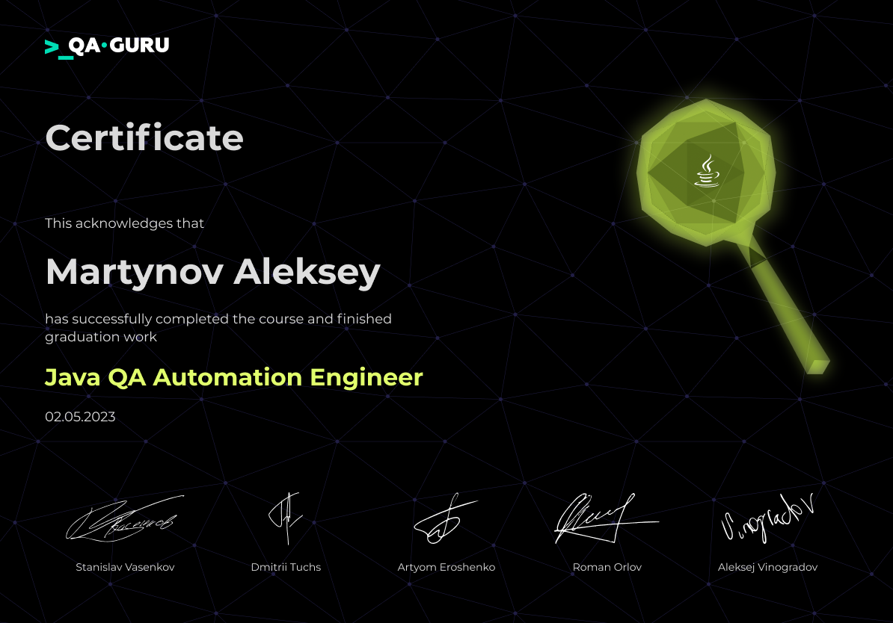
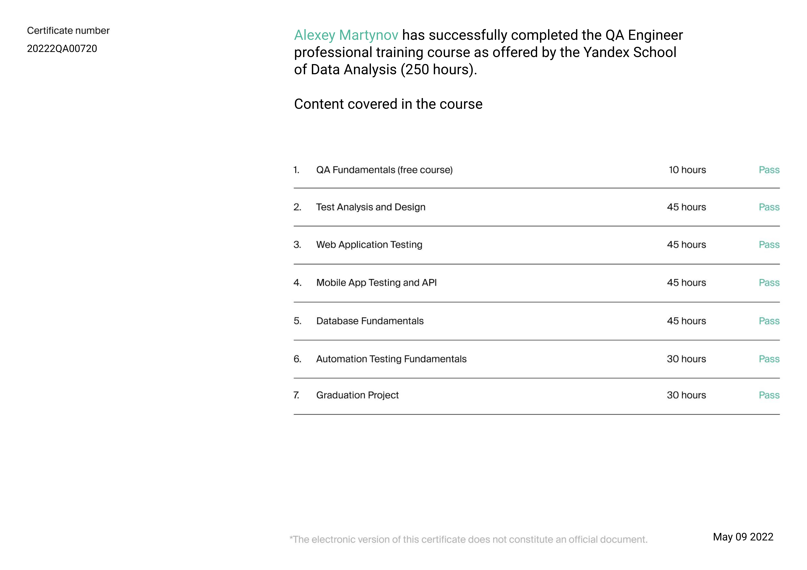

# Алексей Мартынов — QA Engineer

Тестирую сервис персонала Dodo IS в [Dodo Brands](https://github.com/dodopizza): графики и смены сотрудников,
автоматический расчёт графика курьеров, согласование смен через мобильное приложение. Совмещаю ручное
тестирование и автотесты, каждый день работаю в паре с AI-агентом Claude Code.

До QA три года работал во второй линии поддержки Dodo IS, поэтому вижу систему глазами пиццерии — менеджера,
кассира, курьера.

## Чем занимаюсь

- **Ручное тестирование.** За август–сентябрь 2026 — 118 задач и ретестов, 140+ багов; 4 из 5 найдены
  при тестировании задачи, до релиза.
- **Автотесты на C#/.NET** (NUnit, LightBDD) вместе с AI-агентом: за те же два месяца — 1000+ новых
  тест-методов, 44% всех новых тестов сервиса. Ревью и проверка — мои.
- **E2E автоматического расчёта графика** на Playwright и TypeScript: расширил набор до 84 тестов —
  расчёт → менеджер → согласование сотрудником через мобильное API → утверждение. Smoke и регресс
  запускаются кнопкой из PR, отчёты — в Allure TestOps.
- **Качество самих тестов.** Аудит 2200+ автотестов и мутационное тестирование (Stryker.NET): нашёл тесты,
  которые проверяют «метод вызвался», а не результат. Вернул в CI девять тестовых проектов, которые
  не запускались при зелёной сборке. Вместе с коллегой убрали все отключённые тесты сервиса: 47 → 0.

## AI в тестировании

- Агент пишет черновики тест-кейсов, автотестов и баг-репортов. Ревью, проверку на стенде и решение
  «готово» оставляю за собой.
- Автотест принимаю, только когда видел его красным: сломал проверяемое — упал, вернул — зелёный.
- Сначала гипотезы и дешёвые проверки, потом действие. Спорные выводы перепроверяет отдельный агент-скептик.
- Агент знает команду и систему: база знаний на 100+ записей, свои скиллы — засев тестовых данных,
  выкладка на стенд, разбор логов, отчёт о спринте по расписанию.
- Агент работает с браузером, логами Kibana и Grafana, базой стенда и iPhone через MCP и скрипты,
  а я проверяю результат.

## Проекты

### [Ёмкость спринта для Kaiten](https://github.com/toytronic22/kaiten-sprint-capacity)

Панель-закладка для досок Kaiten: сколько работы взяли в спринт по бэку, фронту и QA и сколько команда
успеет с учётом отпусков и праздников. Фиксирует план на старте, считает отчёт о спринте по четырём
вопросам и выгружает цифры на доску Holst. Чистый JavaScript без зависимостей, 200 тестов на `node:test`.
Сделана вместе с агентом; это открытая копия инструмента, которым пользуется моя команда.

### [Блоки для Mindbox](https://github.com/toytronic22/mindbox-blocks)

Делит HTML письма на блоки для нового конструктора Mindbox и к каждому блоку пишет JSON. Работает
в браузере, письмо никуда не отправляется: [открыть страницу](https://toytronic22.github.io/mindbox-blocks/).

## Для себя

Дома тоже тестирую и автоматизирую: меряю, ищу причину, чиню и проверяю, что починилось.

### [Оформление игр не из Steam для Steam Deck](https://github.com/toytronic22/steamdeck-nonsteam-setup)

Добавляешь в Steam игру не из Steam — из GOG или любую с `.exe`, — и через несколько секунд ярлык сам получает
всё, что было бы у оригинала из магазина:

- название вместо имени exe, обложки из магазина Steam;
- версию Proton, с которой игра чаще всего работает по отчётам ProtonDB;
- раскладку контроллера как у оригинала и выбор раскладок сообщества;
- библиотеки Visual C++, DirectX, OpenAL и PhysX, без которых старые игры падают на старте.

Кнопка в Steam показывает отчёт: что нашлось, что поставлено и почему. Python, установка одной командой
без root, 187 тестов.

### Домашний медиакомбайн на Android-приставке

Приставка под Android 14 с внешним диском: загружает фильмы и сериалы, раскладывает их в медиатеку
с человеческими именами и показывает через Kodi на проектор. Код в закрытом репозитории: в нём адреса
и пароли домашней сети.

- **Сторожа на голом `sh`** — в системе нет ни bash, ни curl, только toybox и mksh. Режимы скорости
  загрузки, самолечение, пауза загрузок на время фильма, защита диска от переполнения.
- **Раскладка медиатеки** — опознание фильмов и сериалов по базе фильмов. Что не опознано — в папку
  «Разобрать» для человека, а не наугад.
- **Telegram-бот** на Python — каталог с подборкой «для вас», поиск, загрузки, медиатека, состояние
  приставки; семейный доступ по одноразовой ссылке.
- **Сторож роутера** — каждые 30 секунд проверяет связь и сам переключает туннель, если она пропала.
- **Диагностика по замерам.** Запись на диск проседала до 2–5 МБ/с: по статистике блочного устройства
  нашёл, что черепичному диску через USB не доходит TRIM и каждый кусок пишется 1,6 секунды вместо 10 мс.
  4K-фильм спотыкался ближе к концу: задержка чтения росла с 5,6 до 39,5 мс за три часа, а Kodi 21
  молча игнорировал старые настройки буфера. Оба места починил.

## Стек

## Учёба

- Автоматизированное тестирование на C# — TeachMeSkills, 2026, учусь сейчас.
- Java: автоматизация тестирования — QA.GURU, 2023.
- Инженер по тестированию — Яндекс Практикум, 2022.

Учебные проекты 2022–2023 на Java

- [dodo_ui](https://github.com/toytronic22/dodo_ui) — UI-автотесты сайта Додо Пиццы: Selenide, JUnit 5, Allure.
- [dodo_mobile](https://github.com/toytronic22/dodo_mobile) — мобильные автотесты приложения: Appium, Browserstack.
- [reqres_api](https://github.com/toytronic22/reqres_api) — API-автотесты reqres.in: RestAssured.

Сертификаты

